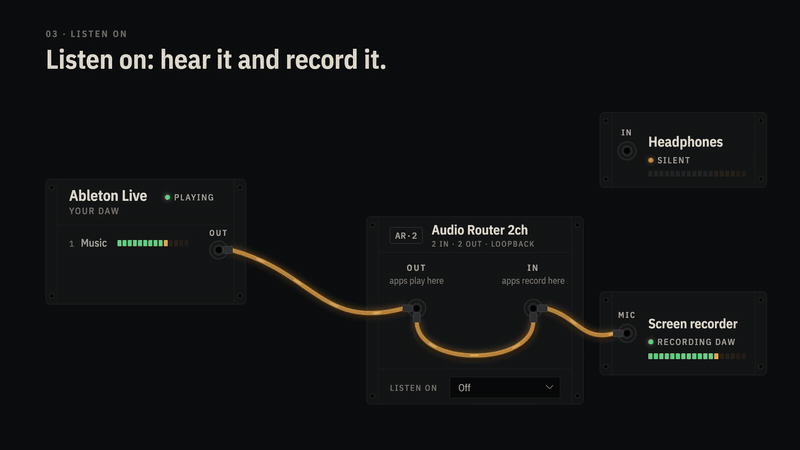
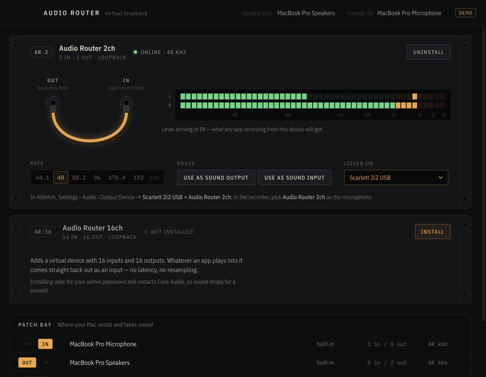

<h1 align="center">Audio Router</h1>

<p align="center">
  A free virtual audio cable for macOS.<br>
  Record your screen with your DAW's sound and your voice, and keep listening on your headphones.
</p>

<p align="center">
  <a href="https://github.com/Jeff909Dev/audio-router/releases/latest"></a>
  <a href="LICENSE"></a>
  
  
</p>

<p align="center">
  <a href="docs/media/audio-router.mp4"></a>
</p>

Audio Router adds a device named **Audio Router 2ch** to your Mac. Whatever an app plays into it comes back out as a microphone, and any other app can record that microphone. The control app also routes the same sound to your headphones, so you hear exactly what you record.

## Features

- A loopback device with 2 channels, and an optional 16-channel one, at sample rates from 44.1 kHz to 192 kHz.
- The driver adds no latency and does not resample. A tone played in comes back out sample for sample.
- **Listen on** creates a Multi-Output Device for your headphones and Audio Router. You hear the sound, and recorders get it at the same time.
- Level meters show the signal that arrives at the input, which is what a recorder will capture.
- One click makes Audio Router the Mac's sound output or input.
- The app has no account, no telemetry, and makes no network requests.

<p align="center">
  
</p>

## Install

1. Download `Audio-Router-<version>-mac.dmg` from the [latest release](https://github.com/Jeff909Dev/audio-router/releases/latest).
2. Open the .dmg and drag **Audio Router** to **Applications**.
3. Open Audio Router. macOS blocks the first launch because the app is not notarized. Follow the steps in [the first launch on macOS](#first-launch-on-macos).
4. On the **Audio Router 2ch** panel, click **Install** and enter your password. Sound stops for about a second while Core Audio restarts.

The app runs on Apple silicon and Intel Macs with macOS 13 or later.

### First launch on macOS

Audio Router is ad-hoc signed and not notarized, because notarization needs a paid Apple Developer ID. On macOS 15 and later, Control-click and **Open** no longer skip the warning.

1. Open Audio Router, and close the warning.
2. Open **System Settings** and go to **Privacy & Security**.
3. In the **Security** section, click **Open Anyway** next to the message about Audio Router. The button stays there for about an hour after the blocked launch.
4. Click **Open Anyway** again, and enter your password.

If you use Terminal, you can remove the quarantine flag instead:

```sh
xattr -dr com.apple.quarantine "/Applications/Audio Router.app"
```

### Check a download

Each release has a `SHA256SUMS.txt` file and a build attestation from GitHub Actions. The attestation proves which commit and which workflow built the file. It does not replace notarization.

```sh
shasum -a 256 -c SHA256SUMS.txt
gh attestation verify Audio-Router-<version>-mac.dmg -R Jeff909Dev/audio-router
```

## Record your screen with your DAW and your mic

This guide uses Ableton Live. Other DAWs have the same settings under other names.

1. In Audio Router, set **Listen on** to your headphones or your audio interface. The app creates a device named after both, for example `Scarlett 2i2 USB + Audio Router 2ch`.
2. In Ableton Live, open **Settings** and go to **Audio**. Set **Audio Output Device** to the device from step 1. Keep **Audio Input Device** on your audio interface.
3. Add an audio track for your mic. Set its input to the interface channel of the mic, and set **Monitor** to **In**. Your voice now plays through the Main track with the music.
4. Press Shift-Command-5 and click **Options**. Under **Microphone**, choose **Audio Router 2ch**.
5. Choose the whole screen or one window, and click **Record**.

The recording gets the same mix that you hear. Any recorder works in the same way. In OBS Studio or QuickTime Player, choose **Audio Router 2ch** as the audio input.

To record the sound of other apps too, such as a browser, click **Use as sound output** on the panel. The Mac's sound then goes through the same Multi-Output Device.

## How it works

The project has three parts.

| Part | Folder | What it does |
| --- | --- | --- |
| Driver | `driver/` | A Core Audio AudioServerPlugIn in C. `coreaudiod` loads it from `/Library/Audio/Plug-Ins/HAL`. |
| `arctl` | `helper/` | A Swift command-line tool over Core Audio. It lists devices, sets the default devices and the sample rate, and creates or removes Multi-Output Devices. |
| App | `app/` | Electron and React. It installs the driver, shows the meters, and calls `arctl` for everything else. |

- **The loopback.** The device has one output stream and one input stream. The driver writes the output mix into a ring buffer at its sample time, and the input reads the same sample time back. After a read, the driver clears those frames, so the input is silent when nothing plays.
- **The clock.** The driver has no hardware clock. It counts frames from `mach_absolute_time`, in the same way as Apple's NullAudio sample driver.
- **Listen on.** `arctl multi-output` creates a stacked aggregate device, which is what Audio MIDI Setup calls a Multi-Output Device. Your headphones drive the clock, and Audio Router follows it with drift compensation. The device UID comes from the two device UIDs, so a second request returns the same device.
- **The meters.** The app opens the input of Audio Router with `getUserMedia` and draws a peak meter from Web Audio analysers.

## Uninstall

1. In the app, set **Listen on** to **Off**. The app deletes the Multi-Output Device.
2. Click **Uninstall** on the panel, and enter your password.
3. Move **Audio Router** from **Applications** to the Trash.

Without the app, run these commands in Terminal:

```sh
sudo rm -rf /Library/Audio/Plug-Ins/HAL/AudioRouter2ch.driver /Library/Audio/Plug-Ins/HAL/AudioRouter16ch.driver
sudo killall coreaudiod
```

Then delete any `+ Audio Router 2ch` device in **Audio MIDI Setup**.

## Troubleshooting

- **The meters stay flat.** The app needs microphone access to read the input of Audio Router. Allow it in **System Settings** > **Privacy & Security** > **Microphone**. Ad-hoc builds have no stable identity, so macOS asks again after each update.
- **You hear nothing.** The Mac's sound goes into Audio Router only. Choose a device under **Listen on**, or click **Back to** on the warning in the panel.
- **You hear the sound late on Bluetooth headphones.** Bluetooth adds about 150 to 250 ms of delay to what you hear. When you play an instrument live, use wired headphones or the headphone output of your interface.

## Build from source

A build that you make on your own Mac has no quarantine flag, so macOS opens it without a warning. You need Xcode 16 or later and Node.js 24 or later.

```sh
git clone https://github.com/Jeff909Dev/audio-router.git
cd audio-router
make                                  # driver, arctl and app
sudo make -C driver install V=2ch     # install the 2-channel driver
make dev                              # run the app
```

`make dist` builds the same .dmg and .zip as a release. [CONTRIBUTING.md](CONTRIBUTING.md) explains the tests and the project layout.

## Limitations

- The app is not notarized. See [the first launch on macOS](#first-launch-on-macos).
- The device has no volume control, so the volume keys do not change its level.

## License

Audio Router is released under the [MIT license](LICENSE). It is an independent implementation on Apple's public `AudioServerPlugIn.h` API, inspired by [BlackHole](https://github.com/ExistentialAudio/BlackHole). It does not use BlackHole code, and it is not affiliated with Existential Audio. Ableton Live is a trademark of Ableton AG.
